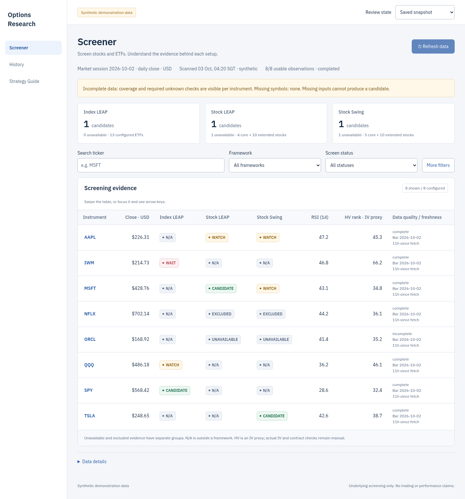
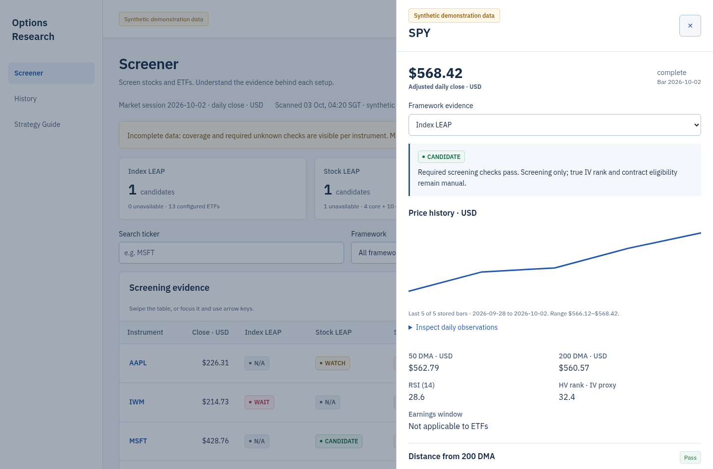
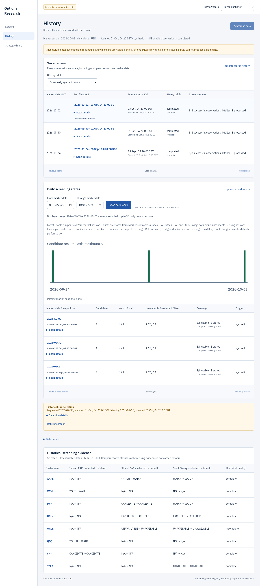
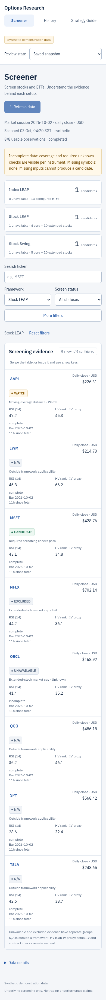
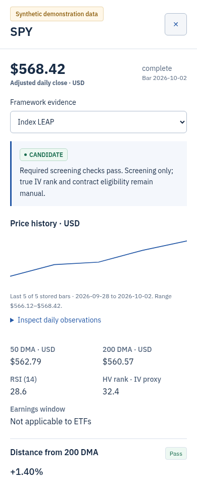
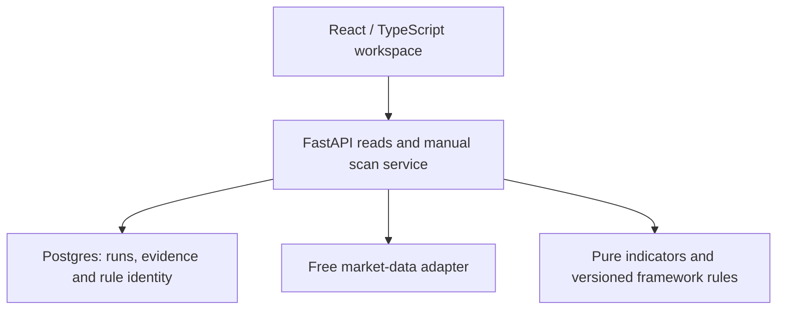

# OptionSift

**A disciplined workspace for options research.**

OptionSift helps a researcher screen stocks and ETFs against three established
frameworks, inspect the evidence behind each result, and review what a past scan
actually recorded. It is a working personal research beta. The application was
built under the development name **Options Research**, which appears in these
authentic product captures.

This repository is a standalone case study. The working application and its
operational source remain private.

## Why build it?

A strategy document can tell a researcher what to check. Doing those checks
consistently across a watch universe is a different problem. Prices, moving
averages, volatility, earnings dates and applicability can come from different
places and change at different times. A favorable-looking setup can depend on
an input that is missing or a rule that does not apply to that instrument.

The project began with three existing framework documents and a legacy personal
dashboard. The product question was concrete: **can those frameworks become a
repeatable research workflow whose results remain explainable and reviewable?**

OptionSift brings the checks, their evidence and their dates into one workspace.
Its intended benefit is a more consistent first pass and a clearer record of
what still needs research. No time-saving or investment-performance result has
been measured.

## The problems it addresses

| Research problem | Product response |
| --- | --- |
| Repeating the same checks across instruments | A versioned engine evaluates each applicable framework consistently. |
| Seeing a label without understanding its cause | Instrument evidence shows measured values, thresholds, reasons and missing inputs. |
| Mistaking incomplete data for a favorable result | Required unknown inputs block candidate status; unavailable evidence stays visible. |
| Applying stock rules to an ETF, or overlooking eligibility | Framework applicability is explicit; outside-framework results are N/A. |
| Losing the context behind yesterday's screen | Immutable scans retain their own dates, coverage, source and rule identity. |
| Confusing a new request with older evidence on screen | History distinguishes the requested run from the displayed run during loading or failure. |

## Screen → inspect → review

| Step | Research question | In the product |
| --- | --- | --- |
| **Screen** | Which underlying assets deserve a closer look? | Search the 28-instrument universe; filter by framework, screen status and observation group. |
| **Inspect** | Why did this setup receive its label? | Open measured checks, stored daily prices, earnings context and unavailable inputs. |
| **Review** | What did the earlier scan actually show? | Select a saved run and compare stored statuses with the latest usable default. |
| **Prepare** | What must I verify at the broker? | Consult framework references, the manual contract checklist and USD premium-budget arithmetic. |

A **CANDIDATE** is an underlying screen for further options-contract research.
It is not a selected option or a trade instruction. Index LEAP, Stock LEAP and
Stock Swing remain separate frameworks rather than one invented aggregate score.

## Working product screens

All six captures use the actual shared React interface with visibly labelled
**Synthetic demonstration data**. Prices, checks, chart bars and historical runs
in these examples are illustrative. They do not represent current market data,
returns or a live provider test.

**1. Find a setup.** Separate framework summaries lead into the screener. Freshness,
daily-close dates, unavailable states and HV as an IV proxy remain visible.



**2. Inspect its evidence.** The instrument drawer connects a status to its measured
checks and stored price observations. Technical provenance is available on demand.



**3. Review the record.** Saved runs retain distinct identities, even when more than
one scan belongs to the same market date. History compares stored screening states.



**4. Keep the evidence usable on a small screen.** The same components serve narrow
layouts, with intentional table scrolling and accessible instrument details.




A [tablet capture](screenshots/tablet-screener.png) shows the middle breakpoint.
These Chromium captures document responsive behavior; they do not establish
physical iPhone, iPad or Safari acceptance.

## Product decisions

The beta deliberately stays small: **one application plus Postgres**, three
inherited frameworks, 28 configured instruments and explicit manual refresh.

- **Keep the framework logic deterministic.** AI-assisted implementation does not
  generate market inputs or replace the accepted numerical rules.
- **Make uncertainty part of the result.** Missing data, exclusions, applicability
  and proxy measures appear with the evidence.
- **Separate reading from fetching.** Opening or navigating the app reads saved
  research. An explicit Refresh requests a bounded scan with progress and cooldown.
- **Preserve the research record.** A new scan creates a new run; old evidence is
  not silently reinterpreted under a later rule version.
- **Use one presentation for real and synthetic evidence.** The showcase uses the
  working components through an explicitly selected synthetic adapter.

[Product decisions and tradeoffs](docs/product-decisions.md) explains why these
choices matter and what the beta leaves for further research.

## Architecture



Read endpoints load stored evidence. The manual scan service coordinates provider
retrieval, pure calculations and persistence. Idempotency and a single active scan
protect explicit refresh intent. The frontend keeps connected and synthetic data
adapters separate from their shared presentation; a failed API read does not
silently become demonstration data.

The application runs locally with a portable database profile compatible with
local Supabase. There is no public application login or hosted backend in this
case study.

## Building with AI

The project used AI coding assistance in a managed cloud environment. The owner
set the problem and boundaries, chose corrections to inherited behavior, reviewed
the design and authorized integration. Work was delivered through bounded changes,
tests and reviewable pull requests.

The useful part of that workflow was the evidence around each change: preserved
baseline calculations, explicit missing-data behavior, fresh review, repeatable
checks and a distinct local acceptance step. The product's numerical engine is
deterministic; AI is part of the building process.

[Build and verification](docs/build-and-verification.md) records the stages,
observed checks and limits without implying that every tool or device was tested.

## Outcome

As of **11 October 2026**, the underlying-asset research beta and approved design
makeover are integrated and operating locally. The delivery includes:

- Screener, instrument evidence, saved-run History, Strategy Guide and USD sizing;
- an observed local scan with 28 of 28 usable observations;
- accepted application/database restart persistence and an isolated backup restore;
- a later rebuilt UI loading 28 instruments and four distinct saved observed runs;
- deterministic regression checks and synthetic captures at desktop, tablet and
  mobile widths.

These are implementation and operational observations. They do not establish
research effectiveness, investment returns or a validated trading strategy.
The current beta does not select contracts, connect to a broker or place orders.

## Reproduce the illustrative example

The included example contains invented values and **pre-recorded labels**. It
demonstrates how a result can retain evidence and missing states; it does not
implement the private scorer or fetch market data.

```sh
node examples/read-evidence.mjs
```

No account, credentials or provider connection is required. The example and the
screenshots are distinct from actual observed market scans.

## Lessons and next questions

The main lessons were about product truth: applicability matters, an unknown is
not a pass, dates belong beside evidence, and a historical result needs its
original identity. Simplifying the interface meant moving technical details into
accessible disclosures while retaining the research warnings.

[Lessons and next questions](docs/learnings.md) separates demonstrated delivery
from optional future work such as private hosting, device acceptance and
contract-level research. This case study makes no promise of those features.

## Scope and rights

Underlying evidence is daily-close data. Historical volatility rank is an
**IV proxy**, not actual implied-volatility rank. Delta, DTE, options volume,
open interest, bid–ask spread and contract eligibility remain manual checks.

Legacy imported evidence is unverified; scan History is not a backtest.
There are no measured return, win-rate or productivity claims.

Case-study text, images, name and illustrative examples are copyright © 2026
Puneet Chugh; no reuse license is granted here. The operational source and private
research are not included. See the [font notice](FONT_NOTICE.md) for the bundled
third-party font's separate SIL Open Font License.

